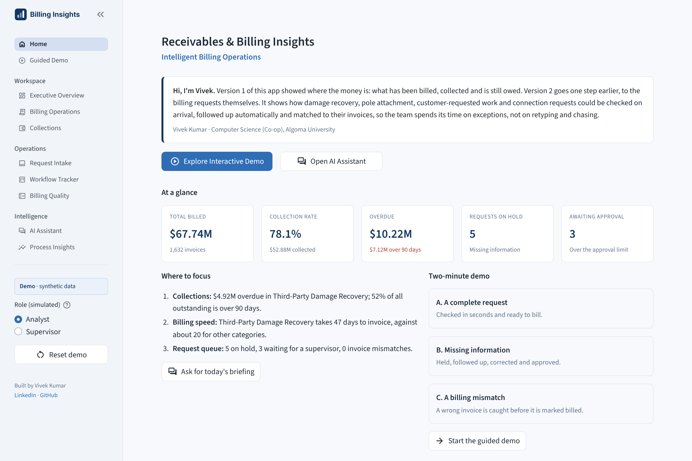
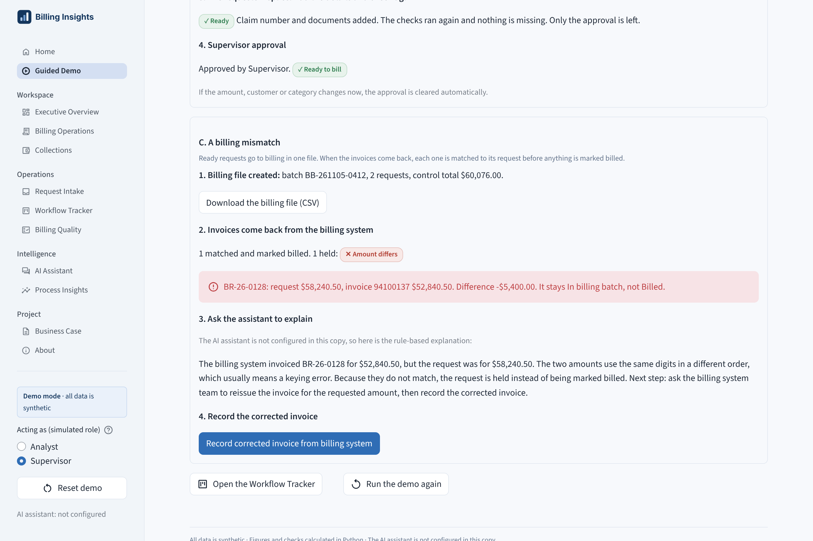
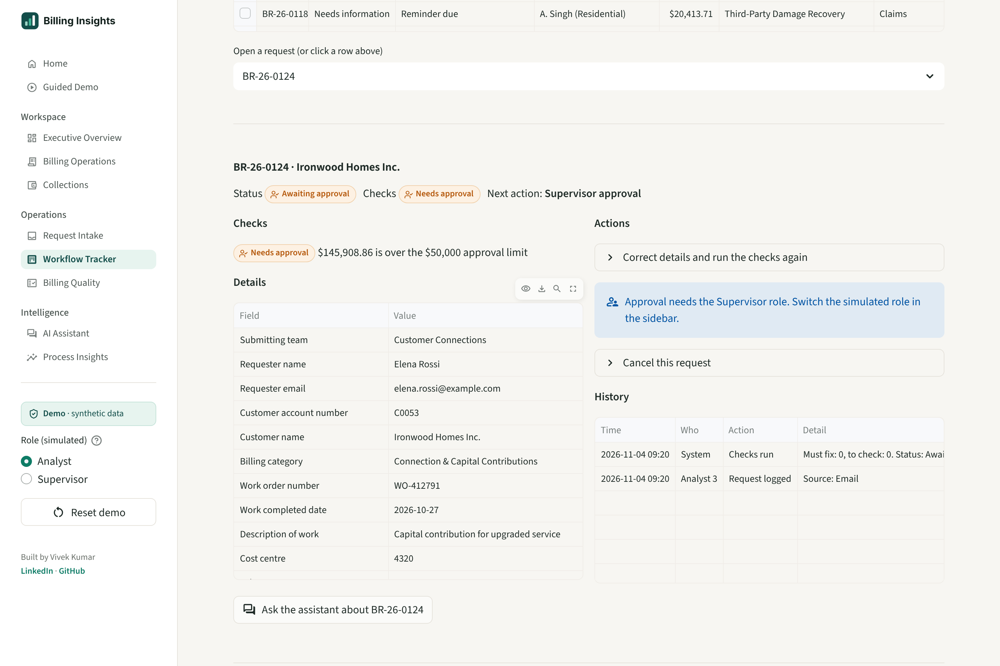
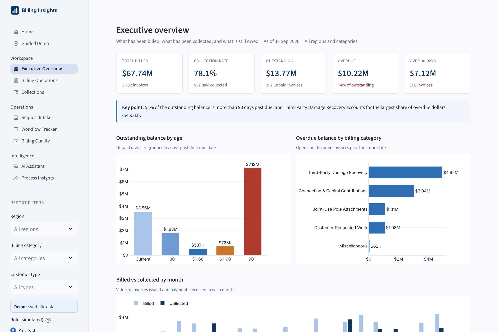
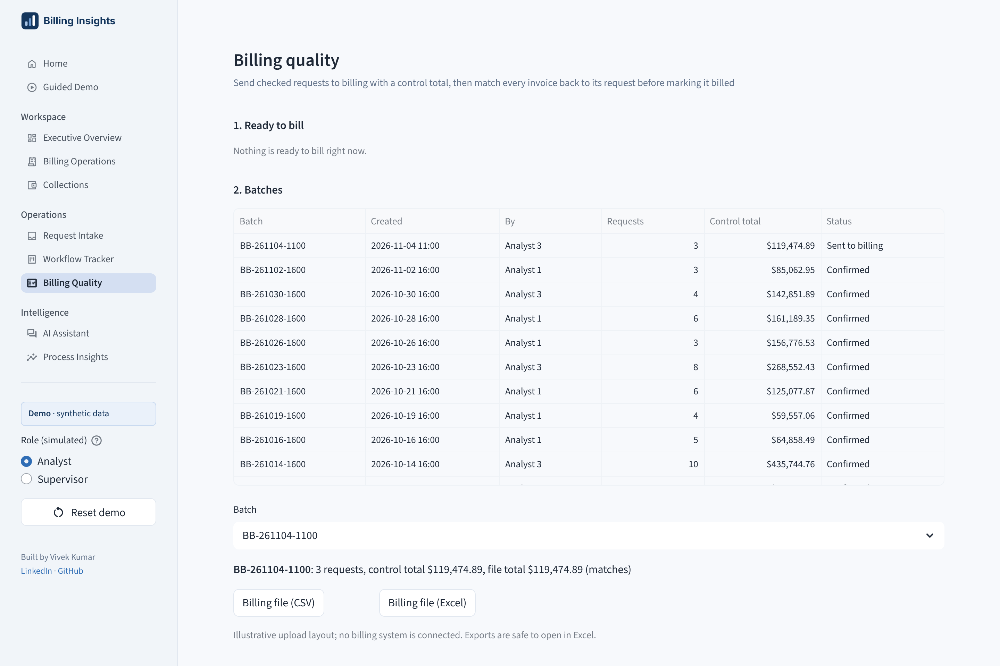
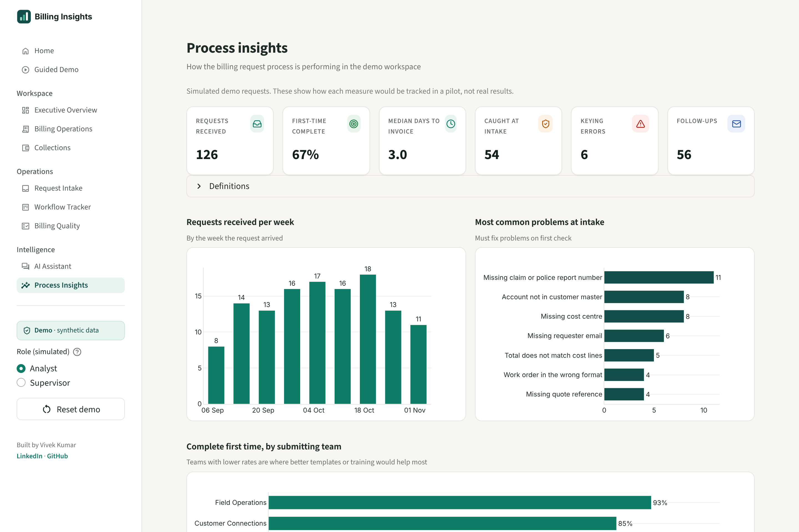
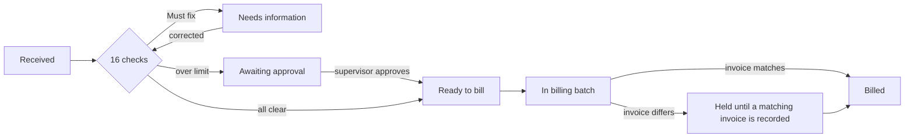

# Receivables & Billing Insights 2.0

**Intelligent Billing Operations.** A working prototype for a utility's billing and receivables team. It shows where money is owed, checks incoming billing requests before they are billed, catches invoice errors before anything is marked billed, and includes an assistant that answers questions from calculated figures.

**Live demo:** _link added after deployment_

All customers, requests and amounts are synthetic. This is an independent portfolio project. It is not affiliated with, commissioned by or endorsed by any company.



## Try it in two minutes

Open **Guided Demo** from the home page. It runs three short scenarios on your own copy of the data:

| Scenario | What happens |
| --- | --- |
| A. A complete request | An email is read, all 16 checks pass, and it is ready to bill with no manual review. |
| B. Missing information | A damage recovery request arrives without its claim number or documents. It is held, a follow-up email is drafted, you add the missing details, the checks run again, and a supervisor (simulated role) approves it because it is over the illustrative $50,000 limit. |
| C. A billing mismatch | Ready requests go to billing in one file with a control total. One invoice comes back with two digits swapped. Reconciliation catches it, so that request stays in the billing batch until a corrected invoice that matches is recorded. |



## What is in the app

| Group | Page | What it does |
| --- | --- | --- |
| | Home | Key figures, today's priorities, the three scenarios |
| | Guided Demo | Scenarios A, B and C |
| Workspace | Executive Overview | Version 1 receivables overview: billed, collected, outstanding, overdue, aging |
| Workspace | Billing Operations | Version 1 billing speed, unbilled backlog, disputes, write-offs, refund turnaround |
| Workspace | Collections | Version 1 ranked worklist, with a payment reminder drafted from a template |
| Operations | Request Intake | Log a request from a form, a spreadsheet upload or a pasted email; checks run before saving |
| Operations | Workflow Tracker | Every request by status, its checks, follow-up draft, approval, corrections and history |
| Operations | Billing Quality | Billing batch, control total, safe CSV/Excel export, confirmation file and reconciliation |
| Intelligence | AI Assistant | One assistant over the reports and the live queue, with suggested questions per page |
| Intelligence | Process Insights | Complete-first-time rate, days to invoice, top problems, results by team, each with its definition |
| Project | Business Case | A one-page proposal for a small pilot |
| Project | About | Version history, how AI is used, privacy and limits |

The Version 1 report pages keep their original figures, filters and definitions, fixed at **30 Sep 2026**. Tests check that the figures match the v1.0 code exactly (for example: billed $67.74M, collection rate 78.1%, overdue $10.22M, over 90 days $7.12M).

| Workflow tracker | Executive overview |
| --- | --- |
|  |  |
| **Billing quality** | **Process insights** |
|  |  |

## The workflow



Only these moves are allowed; anything else is refused. A request can be cancelled before it goes to billing.

**Controls**

- Requests over the approval limit need a supervisor who did not log them. Changing the amount, customer or category clears the approval.
- Every batch carries a record count and control total.
- Nothing is marked billed until its invoice matches. A person reviews the match before confirming it.
- Every change is recorded with who and when.
- Exports are protected against spreadsheet formula injection. Uploads are limited to 1 MB and 200 rows.
- Follow-up emails and reminders are drafts. Nothing is sent from the app.

The approval limit, rate card, cost centres and rules are illustrative, not any company's policy. No real billing system (such as SAP) or email system is connected.

## How AI is used

Python does the work; the AI explains it.

1. Every figure, check, status and match is calculated by plain code and gives the same answer every time.
2. The assistant receives only verified summaries: the Version 1 figures for the current filters, and the visitor's live queue. The exact text is shown under "What the assistant was given".
3. It follows ten rules, including: never invent figures or records, say when the data is not enough, keep observations separate from recommendations, show the evidence, and never take actions.
4. For free-text emails, the AI suggests field values. Each value is checked against the email text, and anything not found there is flagged for a person.
5. Questions and emails are treated as untrusted text: length limits, prompt-injection screening, a per-visitor question cap, and an answer length limit.
6. If the AI fails or is not configured, the app says so. It never shows a made-up answer.

| Where it runs | Provider | Notes |
| --- | --- | --- |
| Public demo | Google Gemini 3.5 Flash-Lite (free tier) | Questions, with fictional demo summaries, are sent to Google. Free-tier prompts may be used to improve Google's products. Free quotas are limited and change over time. |
| Optional | Claude (Anthropic API) | Used if an Anthropic key is configured. Paid. |
| On a laptop | Ollama, `qwen2.5:3b` | Runs locally, so questions stay on the computer. |

## Run it locally

You need Python 3.9 or newer (3.12 recommended).

```bash
python3 -m venv .venv
source .venv/bin/activate
pip install -r requirements.txt
streamlit run app.py
```

Everything works without AI. For the assistant, either:

- install [Ollama](https://ollama.com) and run `ollama pull qwen2.5:3b`, or
- copy `.streamlit/secrets.toml.example` to `.streamlit/secrets.toml` and add a Gemini or Anthropic key. This file is never committed. The hosted SDKs need Python 3.11+ (Gemini) or 3.10+ (Claude).

Run the tests with `pip install pytest` and then `python -m pytest`.

## Deploy on Streamlit Community Cloud (free)

1. Sign in at [share.streamlit.io](https://share.streamlit.io) with GitHub and click **Create app**.
2. Choose this repository, the branch, and `app.py` as the main file.
3. Under **Advanced settings**, choose Python 3.12 and paste the secrets (see `.streamlit/secrets.toml.example`).
4. Click **Deploy**.

Free apps sleep after a period without visitors and wake when someone opens the link, which takes a short while. Free AI quotas are shared by all visitors.

## Project structure

```
app.py                  Navigation and shared sidebar only
core/receivables.py     Version 1 data loading and metrics, moved without changes
workflow/rules.py       The 16 checks, approval rule and follow-up email text
workflow/store.py       Tracker (in-memory SQLite per visitor), status moves, approvals, batches, reconciliation, history
workflow/extract.py     Email reading: template parser, AI for free text, check against the email
workflow/scenarios.py   Guided demo scenarios A, B and C
workflow/sample_data.py Synthetic workflow history, built on the Version 1 customer list
workflow/exports.py     Safe CSV/Excel export and upload limits
ai/providers.py         Gemini, Claude and Ollama behind one interface, with honest errors
ai/context.py           The assistant's rules and verified context
ai/guard.py             Input, output and rate limits, prompt-injection screening
views/                  One file per page
tests/                  Version 1 figures, workflow controls, AI safety, exports, and the running app
data/                   Synthetic workbook and the script that generates it
```

## Version history

| Version | Summary |
| --- | --- |
| [v1.0](https://github.com/DevModeVivek/receivables-billing-assistant/tree/v1.0) | Receivables overview, billing operations, collections worklist and a local AI assistant (Ollama). Screenshots are archived in [`docs/screenshots/v1`](docs/screenshots/v1). |
| 2.0 | Grouped navigation, home page and guided demo; request intake, checks, workflow tracker, approvals, billing batches and reconciliation; process insights; one assistant over reports and workflow with hosted or local AI; safety limits; tests. |

The Version 1 data model was also built in Power BI (star schema, eight relationships, eleven DAX measures), which was used to cross-check the figures.

## Author

Vivek Kumar, Computer Science (Co-op) student at Algoma University. [LinkedIn](https://www.linkedin.com/in/vivek-kumar-812211247) · [Portfolio](https://vivekkumarportfolio.vercel.app)
