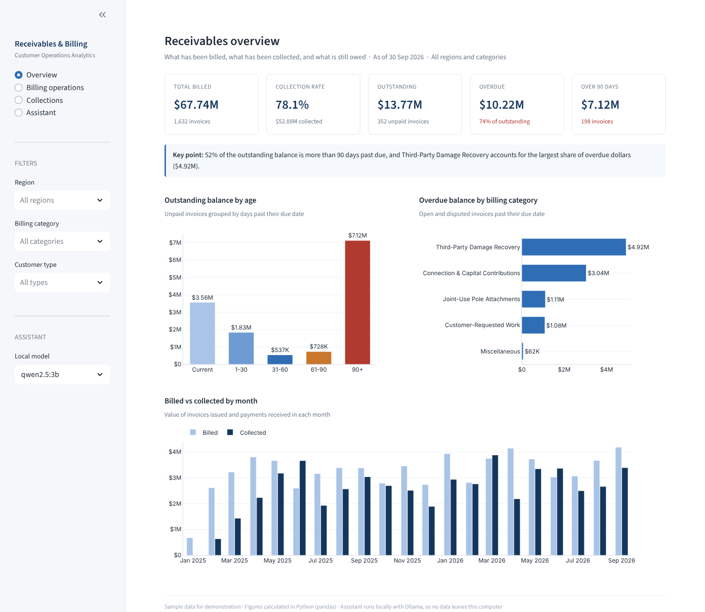
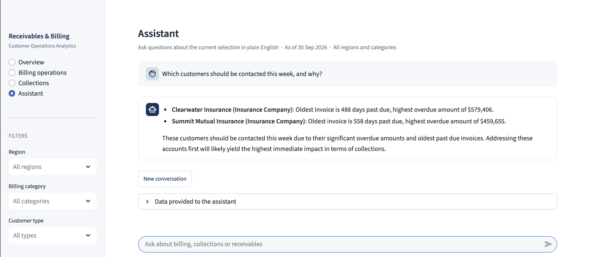
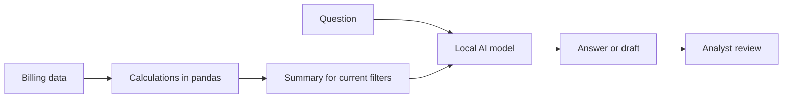
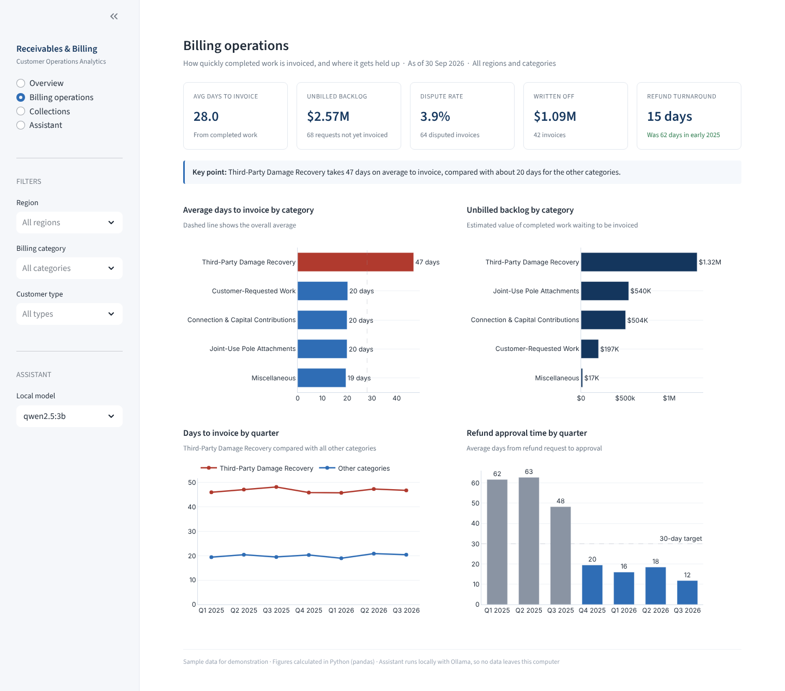
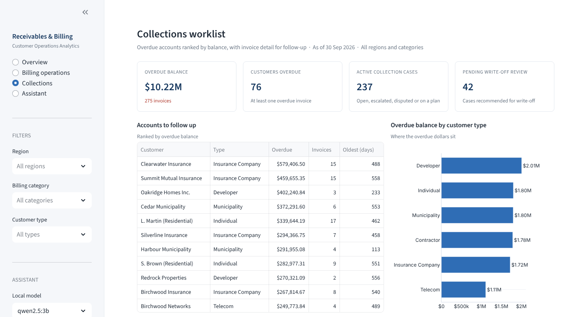

# Receivables & Billing Insights

A billing and accounts receivable report with a built-in AI assistant, designed for a utility's non-energy billing team. Managers can see what has been billed, collected and still owed, find where billing gets held up, work a ranked collections list, and ask questions in plain English.

The AI runs locally through [Ollama](https://ollama.com), so no data leaves the computer. **All data in this repository is synthetic.**



## What it does

| Page | What it shows |
| --- | --- |
| Receivables overview | Billed, collected, outstanding and overdue balances, aging buckets, overdue by billing category, billed vs collected by month |
| Billing operations | Days from completed work to invoice by category and quarter, unbilled backlog, dispute rate, write-offs, refund turnaround against a 30-day target |
| Collections worklist | Overdue accounts ranked by balance, invoice detail, active collection cases, and an AI-drafted payment reminder for analyst review |
| Assistant | A chat that answers questions such as "Where should collections focus first?" or "Summarise the receivables position for a weekly leadership update" |

Every page follows the same filters: region, billing category and customer type.



*A real answer from the local model. The accounts, balances and invoice ages match the report's figures.*

## How the AI is used safely



- **Numbers are calculated, never generated.** Every figure comes from pandas. The model only explains figures it is given.
- **It sees summaries, not full records.** The model receives totals and rankings for the current filters, never contact or banking details.
- **It must stay on the data.** Its instructions say to quote only the figures provided and to say when the data does not cover a question.
- **Anyone can check what it saw.** The Assistant page has a "Data provided to the assistant" panel showing the exact summary.
- **People stay in control.** Reminder emails are drafts for an analyst to review before sending.

## Screens

| Billing operations | Collections worklist |
| --- | --- |
|  |  |

## Run it locally

You need Python 3.9 or newer and [Ollama](https://ollama.com).

```bash
ollama pull qwen2.5:3b
python3 -m venv .venv
source .venv/bin/activate
pip install -r requirements.txt
streamlit run app.py
```

The report pages work without Ollama; the assistant and email drafts need it running.

## Project structure

```
app.py                         Streamlit app: calculations, charts and assistant
data/billing_sample_data.xlsx  Synthetic data (customers, billing requests, invoices, payments, collection cases, refunds, dates)
data/generate_sample_data.py   Script that generates the synthetic data (fixed seed, as of 30 Sep 2026)
.streamlit/config.toml         Theme
docs/screenshots/              Screens used in this README
```

## Power BI version

The same data model was also built in Power BI: a star schema of seven tables with eight relationships, eleven DAX measures, and two report pages (receivables overview and billing operations). Both versions produce the same figures, which was used to validate the calculations.

## Measure definitions

| Measure | Definition |
| --- | --- |
| Outstanding | Invoice amount minus amount paid, for open and disputed invoices |
| Overdue | Outstanding balance on invoices past their due date (invoice date plus 30 days) |
| Collection rate | Payments received divided by total billed |
| Days to invoice | Invoice date minus the date the work was completed |
| Unbilled backlog | Estimated value of completed work requests not yet invoiced |
| Refund turnaround | Approval date minus refund request date |

## Tech stack

Python, pandas, Streamlit, Plotly, Ollama (qwen2.5:3b), Power BI and DAX.

## Author

Vivek Kumar, Computer Science (Co-op) student at Algoma University. [LinkedIn](https://linkedin.com/in/vivek-kumar) · [Portfolio](https://vivekkumarportfolio.vercel.app)
